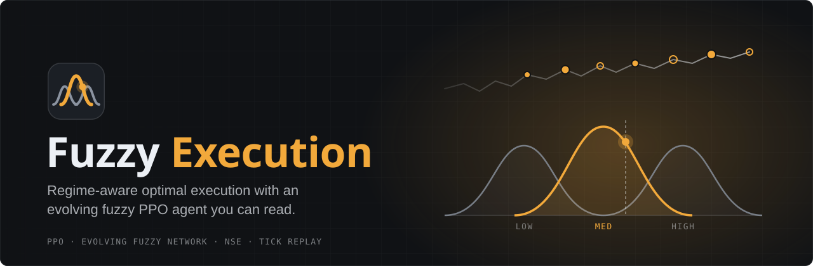
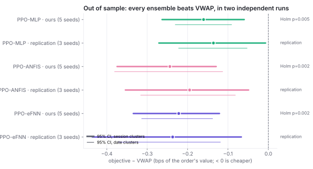
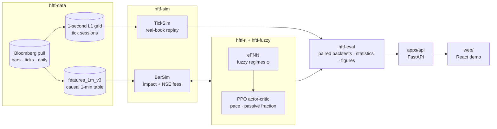
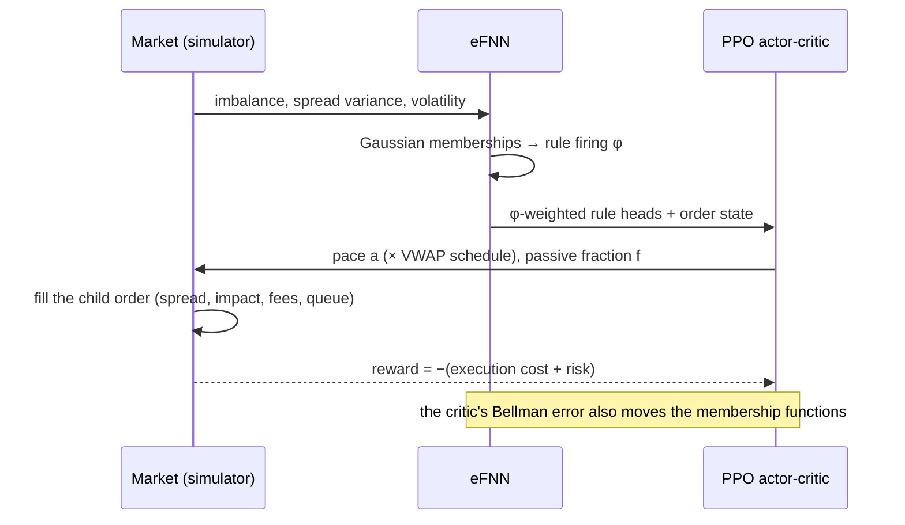
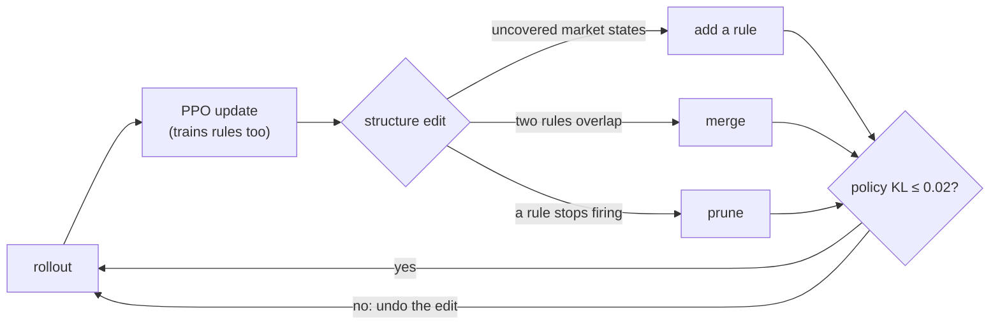

<p align="center">
  
</p>

<p align="center">
  
  
  
  
  
  
  
  
  
  
  <br>
  
  
  
</p>

**Fuzzy Execution** is a reinforcement-learning agent that executes large stock orders on India's NSE at
lower cost than the standard VWAP schedule, and explains every decision. A PPO actor-critic decides how fast
to trade (and, optionally, how much to post as limit orders). Its state passes through an **evolving fuzzy
neural network (eFNN)** that turns order-book imbalance, spread variance and volatility into market regimes,
**adding, merging and pruning rules** as regimes appear and fade. Each decision traces back to a rule such as
*IF spread variance is high and volatility is high THEN slow down*.

> [!NOTE]
> A university project for an Intelligent Systems course. Results come from a market simulator built on
> Bloomberg data for three Nifty-50 stocks (Jun-Oct 2026). They are research results, not trading advice or a
> claim about live savings.

> [!IMPORTANT]
> The market data is licensed (© Bloomberg L.P.) and is **not** in this repository, and neither are the trained
> checkpoints (`runs/`). The code, the tests (on synthetic data), the documentation and the aggregate result
> figures are.

## Results at a glance

Costs are in basis points (bps) of the order's value; negative is cheaper than the benchmark. Every policy runs
on identical orders, with 95% confidence intervals from a session-cluster bootstrap and Holm-adjusted Wilcoxon
tests.

| Question | Answer | Evidence |
|---|---|---|
| Does the agent beat VWAP on unseen days? | **Yes:** MLP −0.16, ANFIS −0.24, eFNN −0.22 bps (Holm p ≤ 0.005) | held-out October test split, 5-seed ensembles |
| Does it reproduce? | **Yes:** −0.14 / −0.20 / −0.24 bps in an independent retraining | 3 new seeds, different episodes |
| Does it survive replay against the real order book? | **Yes, and the edge grows:** −0.17 / −0.20 / −0.18 bps | tick-replay simulator (TickSim) |
| Do learned limit orders help? | **Yes:** −0.43 to −0.46 bps vs always posting passively, with a lighter tail | TickSim; fills are counterfactual |
| Does the fuzzy network beat the plain network? | **Not established:** no difference survives Holm (p ≥ 0.32) | both runs |

<p align="center">
  
</p>

> [!TIP]
> Every number, ablation, robustness sweep and caveat is in **[docs/RESULTS.md](docs/RESULTS.md)**. Slide-ready
> figures (SVG and PNG, with captions and sources) are in **[docs/figures/](docs/figures/README.md)**; regenerate
> them with `uv run hftf report figures`.

## How it works



**One decision, every minute.** The agent observes the market and its own progress, the eFNN says which regime
it is in, and PPO chooses a pace relative to the VWAP schedule:



**The rule base evolves between PPO updates**, and an edit that would move the policy too much is undone:



The design, with every decision and its reason, is in [docs/ARCHITECTURE.md](docs/ARCHITECTURE.md).

## The demo app

A local web app replays real orders and shows the agent's reasoning
([design](docs/UI_DESIGN.md), [3-minute script](docs/DEMO_SCRIPT.md)).

| Screen | What it shows |
|---|---|
| **Overview** | the headline results |
| **Execute** | pick or draw an order; every policy executes it on the same market, minute by minute: price and fills, inventory, cost vs VWAP, live standings and the rule firing now |
| **Brain** | the eFNN's rules as ellipsoids in its 3D regime space, the order's path through it, and the full rule base in plain language |
| **Evidence** | each claim with its statistics, our run beside the replication, robustness sweeps, and what is *not* established |
| **Training** | the learning curve, rules being added, merged and pruned, and every edit against the KL guard |

```bash
uv run hftf serve                       # API on http://127.0.0.1:8000 (needs data/ and runs/)
cd web && npm install && npm run dev    # app on http://127.0.0.1:5173
```

## Quick start

Requirements: [uv](https://docs.astral.sh/uv/) ≥ 0.5 (it fetches Python 3.12; torch installs as a CPU build)
and Node.js 22 for the web app.

```bash
uv sync                                  # all workspace packages + dev tools
uv run pytest                            # 99 tests on synthetic data (no licensed data needed)
cd web && npm install && npm test        # 24 frontend tests
```

With the data in `data/is2/bbg_data/` (or `HFTF_RAW_DIR`):

```bash
uv run hftf data build-features          # final feature table (+ manifest)
uv run hftf data audit --strict          # readiness gate R01-R12
uv run hftf data build-l1                # 1-second L1 grid for TickSim
uv run hftf train ppo --run efnn_s0 --policy fuzzy --seed 0          # eFNN, ~11 min on CPU
uv run hftf eval compare mlp='runs/m4_mlp_s*/best.pt' efnn='runs/m4_efnn_s*/best.pt' --vs mlp --by security
uv run hftf eval rules runs/m4_efnn_s0/best.pt                       # the rules in plain language
uv run hftf report figures                                           # docs/figures/*.svg|png
```

> [!WARNING]
> `--split test` evaluates on the held-out test split. It has been used for the final evaluation and one
> disclosed replication; do not select models or tune anything on it.

## Repository layout

| Path | Role |
|---|---|
| `packages/hftf-data` | Bloomberg loaders, tick cleaning, causal features, the 1-second L1 grid, the readiness audit |
| `packages/hftf-sim` | batched execution simulators (BarSim, TickSim), impact, NSE fees, limit-order fills |
| `packages/hftf-fuzzy` | the evolving fuzzy layer: Gaussian memberships, TSK heads, add / merge / prune |
| `packages/hftf-rl` | PPO, MLP and fuzzy actor-critics, structure evolution with the KL guard |
| `packages/hftf-eval` | baselines (TWAP, VWAP, POV, Almgren-Chriss), paired statistics, per-order traces, figures |
| `apps/cli` | the `hftf` command |
| `apps/api` | the demo API (FastAPI) |
| `web/` | the demo app (React, Vite, ECharts, three.js) |
| `configs/` | YAML for the environment, fees, eFNN, PPO and the demo |
| `docs/` | design, data audit, results, figures, demo plan and script |

## Documentation

| Document | Contents |
|---|---|
| [project_context.md](project_context.md) | domain primer, data dictionary and invariants: start here |
| [docs/ARCHITECTURE.md](docs/ARCHITECTURE.md) | the design and the decision log |
| [docs/RESULTS.md](docs/RESULTS.md) | every experiment, with commands to reproduce it |
| [docs/figures/](docs/figures/README.md) | slide-ready figures with captions and sources |
| [docs/DATA_AUDIT.md](docs/DATA_AUDIT.md) · [DATA_TRANSFORMS.md](docs/DATA_TRANSFORMS.md) · [DATA_READINESS.md](docs/DATA_READINESS.md) | what the data contains, every transformation, and the readiness gate |
| [docs/DEMO_PLAN.md](docs/DEMO_PLAN.md) · [UI_DESIGN.md](docs/UI_DESIGN.md) · [DEMO_SCRIPT.md](docs/DEMO_SCRIPT.md) | the demo's backend, design and walkthrough |

## Data at a glance

Three Nifty-50 stocks (Adani Enterprises, Adani Ports, Apollo Hospitals): 96 sessions of 1-minute bars
(Jun-Oct 2026), 20 sessions of ~1-second order-book ticks, index context and 15 years of daily history. The
audit fixed inflated tick volumes, crossed quotes and missing tick sizes, and rebuilt order-book imbalance for
days without ticks. Sessions run 09:15-15:15 (NSE's closing auction starts at 15:15). The final table has 92
usable sessions per stock: 60 train, 20 validation, 12 test. Nothing is imputed across sessions.

## Team

Krish Kamra, Dhanya Hariya and Tejas Kini.

## License

Code: [MIT](LICENSE). Market data © Bloomberg L.P. is not covered by the license and must not be redistributed.
