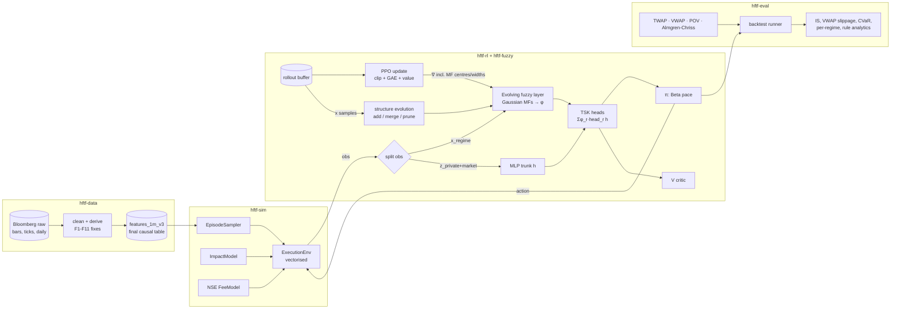

# Architecture Plan (v1)

This plan is definite so we can build against it. It is open to change: when something changes, edit
this file in the same PR and log the change in the [Decision log](#decision-log).

## 1. Problem statement

**Optimal execution of a parent order under regime shifts.** At a decision time `t0` we receive a parent order
(side, `Q` shares, horizon `H` minutes) for one NSE stock. We split it into child orders over the
continuous session to minimise **implementation shortfall (IS)** against the arrival mid-price,
including NSE transaction costs, subject to finishing by `t0 + H`.

The agent's state includes a **regime representation** from an **evolving fuzzy neural network (eFNN)**.
Its inputs are L1 order-book imbalance, bid-ask spread variance and realized volatility. The eFNN adds,
merges and prunes fuzzy rules as the regime distribution shifts. The membership functions are trained
end-to-end by the PPO actor-critic losses, which include the Bellman (TD/GAE) value loss.

> Scope: this is intraday **execution at 1-minute (later sub-minute) decision frequency**. We optimise
> slicing, not latency. "HFT" here means microstructure-aware execution, not colocated market-making.

## 2. System overview



## 3. Data layer (`hftf-data`), built

- Raw Bloomberg pull (read-only) → `loaders` → `ticks` (cleaning) / `derive` (missing quantities) →
  `features.build_feature_table` → `data/processed/features_1m_v3.parquet` (+ manifest), the final dataset.
- **Invariant:** a row stamped `time` (bar start, UTC) uses only information available at
  `decision_time = time + 1 min`. Rolling windows reset each session. The volume profile uses previous
  sessions only. Daily features are lagged one session.
- **Grid and gaps:** 09:15-15:15 IST (360 min) every day, because there is a closing call auction from
  2026-08-03. Incomplete sessions are dropped whole and never imputed. Within-session fills are flagged
  (`fill_trade`, `fill_quote`), as are warm-up estimates (`dq_warmup`). Each row has a `split` label (DATA_AUDIT F10-F11).
- See `docs/DATA_AUDIT.md` for the quirks and fixes, and `project_context.md §Data` for the column dictionary.

## 4. Execution environment (`hftf-sim`)

### 4.1 Episode
| Item | v1 choice | Notes |
|---|---|---|
| Unit | (stock, session, `t0`, `H`, side, `Q`) | sampled by `EpisodeSampler` |
| Horizon `H` | {30, 60, 120} min | `t0` uniform on [09:20, 15:15 − H]; avoid the first 5 min; the grid ends at 15:15 (closing auction) |
| Size `Q` | `ρ · Σ_{t0}^{t0+H} prof_avg_vol` with `ρ ~ LogUniform[1%, 20%]` | expected participation |
| Side | buy / sell, 50/50 | the env is side-symmetric through signed prices |
| Decision step Δ | 1 min (BarSim) | TickSim later: 5-15 s on tick days |
| Termination | `t = t0 + H` with the residual forced as a market order | the forced cost is in the final reward |

### 4.2 Observation (all standardised by train-split statistics)
- **Regime input `x` → eFNN (d = 3):** `imb_bar_proxy` (5-min EMA), `log(spread_var_30m + ε)`, `log(rv_30m + ε)`.
  Use the **bar proxy on every split**, not the mixed `l1_imb` column. Train has only proxy days and test
  has only tick days, and the two sources have different scales (std 0.42 vs 0.32). Mixing them would hand
  the eFNN a source shift that looks like a regime shift. Tick L1 imbalance is reserved for analysis and TickSim.
  Optional extension (config): `rel_volume`, `ofi_norm_5m` (tick days only).
- **Private `z_p`:** remaining inventory fraction, remaining time fraction, IS so far (bps), last pace
  action, schedule deviation (executed − VWAP-schedule fraction).
- **Market `z_m`:** `spread_bps`, `dev_vwap_bps` (signed), `ret_5m` (signed by side), expected share of the
  remaining volume in the next 5 min (from the profile), `ctx_nifty_ret_30m` (signed), `ctx_vix`.
- **Side symmetry (built):** the policy never sees `side`, so every directional column is multiplied by it:
  `imb_bar_proxy_ema5` (so the eFNN sees "imbalance with/against us"), `dev_vwap_bps`, `ret_5m`,
  `ctx_nifty_ret_30m`. Signed columns are scaled by the train std but **not centred**, so the sign flip is an
  exact mirror; the others are z-scored. Stats come from train rows from the 09:20 decision (as in the
  manifest), and z-scores are clipped to ±5. Layout: `hftf_sim.obs_names()` = x (3) · z_p (5) · z_m (6).

### 4.3 Action: pace multiplier
`a_t ∈ [0, a_max]` (`a_max = 4`), sampled from a **Beta** distribution scaled to that range.
Child size `q_t = clip(a_t · X_t · w_t / Σ_{s≥t} w_s, 0, min(X_t, π_max · V̂_t))`, where `X_t` is the
remaining inventory, `w` is the expected volume profile, and `π_max = 0.3` caps participation.
`a = 1` reproduces adaptive VWAP, `a = 0` waits, and `a > 1` front-loads. This parameterisation makes the
naive policy a strong baseline and keeps the action meaning stable across `Q` and `H`.
*v2:* add a discrete head for order type {market, limit@touch} with a fill-probability model on tick days.

### 4.4 Fill model (BarSim)
Children execute at minute `t+1` as aggressive orders:

```
p_exec = m̃_{t+1} + side · ( s_{t+1}/2  +  η · σ_{t+1} · (q_t / V_{t+1})^β )      temporary
m̃_t   = m_t + side · Σ_{u<t} γ · σ_u · (q_u / V_u)^β · exp(−(t−u)/τ_res)          transient (OW-style)
```
- `m`, `s`, `V` are the historical mid, spread and realised minute volume. `σ` is the 1-min vol from `rv_30m`
  (`rv_30m/√30`). As built, impact terms are fractions of the mid: `p = m·(1 + side·(D + s/2 + η·σ·(q/V)^β))`
  with `D` the decayed transient displacement (`hftf_sim/impact.py`).
- `V_eff = max(V, 1% of expected volume, 1 share)` guards (near-)empty minutes (1 zero-volume usable minute).
- Children are whole shares. The last step force-executes the residual and ignores the participation cap.
- *Deferred to TickSim (M5):* children with `q ≤` L1 depth paying half the spread only. BarSim always adds
  the temporary impact term.
- Defaults: `β = 0.5` (square-root law), `η = 0.5`, `γ = 0.3`, `τ_res = 5 min`. **Domain randomisation**
  draws `η ∈ [0.25, 1.0]`, `γ ∈ [0.1, 0.5]` and `τ_res ∈ [2, 15]` per episode, because our own impact cannot
  be identified from public data. Robustness to these parameters is a reported result, not a hidden assumption.
  Draws come from each episode's own seed, so paired policies face identical impact. Evaluation defaults to
  the fixed defaults (`hftf eval baselines --randomise-impact` to draw).
- Counterfactual caveat: historical prices are not affected by our past trades except through `m̃`.

### 4.5 Costs (`configs/fees_nse.yaml`, configurable, verify against current circulars)
STT (0.1% buy and sell, delivery), NSE transaction charge (0.00297%), SEBI fee (₹10/crore), stamp
duty (0.015% buy), GST 18% on (brokerage + exchange + SEBI), and brokerage (bps, plus an optional fixed
amount **per child order**).
Proportional fees barely depend on how the order is sliced. **The per-child fixed fee is what penalises
over-slicing**, so the slice count becomes a real trade-off.

### 4.6 Reward (bps of arrival notional, per step)
```
r_t = − side · (p_exec,t − m_0)/m_0 · (q_t/Q) · 1e4   − fees_t(bps)   − λ · (σ_t·1e4)² · (X_{t+1}/Q)² · Δ
```
`m_0` is the mid of the row observed at `t0`. The risk term uses the inventory **left after** the child
(`X_{t+1}`), as in discrete Almgren-Chriss (`Var = σ²Σ x_k²`, `k ≥ 1`), so immediate execution carries no
timing risk.
Summed over an episode, this gives `−(IS + fees + λ·risk)`, the Almgren-Chriss objective. Defaults are
`λ = 1e-4` (swept), and running-std reward scaling is applied in the trainer.

### 4.7 Implementation
A pure-numpy **batched env** (`BatchExecutionEnv`, N episodes stepped together) with a thin
`gymnasium.Env` wrapper for compatibility. There is no GPU, so environment throughput dominates
training time. Market arrays are held per session as `(n_sessions, 360)` arrays (`MarketData`) and
indexed per step by `(session, row0 + k)`, which is equivalent to pre-slicing and cheaper. `autoreset=True`
(training) re-samples finished envs; `autoreset=False` (evaluation) runs a fixed batch. Throughput: about
4,000 episodes per baseline in 0.2 s. Baselines (`hftf-eval`) act in shares through `step_shares` and are
not participation-capped, except VWAP, which is the pace action `a = 1`.

## 5. Evolving fuzzy layer (`hftf-fuzzy`)

### 5.1 Inference (first-order TSK, product t-norm)
For standardised `x ∈ ℝ^d` and rules `r = 1..R` with centres `c_r` and widths `σ_r = softplus(ρ_r)` (diagonal):
```
τ_r(x) = exp(−½ Σ_j ((x_j − c_rj)/σ_rj)²)      firing strength
φ_r(x) = τ_r / (Σ_k τ_k + ε)                    normalised, a soft regime assignment
```
Heads are fuzzy-gated mixtures of linear experts over the trunk embedding `h = MLP([z_p, z_m, x])`:
```
actor:  (α, β) = 1 + softplus( Σ_r φ_r · (A_r h + b_r) )
critic: V      =             Σ_r φ_r · (u_r·h + d_r)
```

### 5.2 Parameter learning: "Bellman updates shape the memberships"
`c_r` and `ρ_r` are `nn.Parameter`s. The PPO loss `L = L_clip − c_e·H + c_v·L_V` back-propagates into
them. `L_V` is the TD(λ)/GAE regression loss, so the critic's Bellman error moves the MF centres and
widths. The antecedents get their own optimizer param group with a lower learning rate (default 0.3× the
base LR). Config flag `antecedent_grad: {all, value_only, none}`. `value_only` ties MF shaping purely to
Bellman error and is an ablation.

### 5.3 Structure evolution (between PPO iterations)
Structure is edited **only after the update epochs and before the next rollout**. PPO's importance
ratio needs the stored `log π_old` to come from the exact network that collected the buffer.
1. **Add** (novelty): take buffer samples with `max_r τ_r(x) < τ_add` (default 0.15). If at least
   `n_min` (default 64) of them exist, add one rule at their mean with width = their std (floored).
   The new consequent is initialised **function-preserving**: it copies the firing-weighted average of the
   existing consequents at those samples, so the policy does not jump.
2. **Merge:** if two rules overlap (Bhattacharyya coefficient > `τ_merge`, default 0.8), replace them with
   a support-weighted merge.
3. **Prune:** utility `U_r` = EMA over iterations of `mean_x φ_r(x)`. Prune a rule if `U_r < τ_prune`
   (default 0.02) and its age ≥ `a_min` iterations.
4. Guards: `R ∈ [R_min=2, R_max=16]`, at most one add and one prune per iteration, and a cooldown.
   After each edit, rebuild the optimizer param groups (keep Adam state for surviving tensors) and log
   the event.
Initialisation: `R0 = 4` rules from k-means on the regime inputs of the training split's first rollout.

### 5.4 Interpretability
Each rule centre is mapped to linguistic terms per input (Low/Med/High from train terciles) and to its
mean pace action. `hftf eval rules` prints, for example, *"IF spread-var HIGH ∧ RV HIGH ∧ imbalance NEUTRAL
THEN pace 0.62 (slow down)"*. Rule activations are compared with the eval-only regime labels using
adjusted mutual information.

## 6. Learning (`hftf-rl`)

PPO uses the clipped surrogate (ε = 0.2), GAE (γ = 1.0 because episodes are finite and IS-additive,
λ = 0.95), 10 epochs × 8 minibatches, Adam 3e-4, entropy 1e-3, value-loss coefficient 0.5, gradient
norm clip 0.5, target-KL early stop at 0.02, advantage normalisation, running observation/reward
normalisation, and 64 parallel episodes × 120 steps per rollout. The trunk is 2×64 tanh. Policies are
`MLPActorCritic` (baseline) and `FuzzyActorCritic` (eFNN; also runs as static ANFIS with evolution off).
After each update, `EvolutionCallback` applies §5.3. Logging goes to TensorBoard and CSV, and checkpoints
include the fuzzy structure (R varies).

## 7. Evaluation (`hftf-eval`)

- **Splits (walk-forward by date, train statistics only):** train 2026-06-03 → 08-31; val 09-01 → 09-30;
  test 10-01 → 10-19, all of which are tick days. That gives 60 / 20 / 12 sessions per stock. 06-03 → 06-05
  (profile burn-in) and the partial 10-21 are `excluded`, and 09-10 is absent. A secondary generalisation
  check is leave-one-stock-out.
- **Baselines:** immediate (all at t0), TWAP, VWAP (profile), POV(10%), Almgren-Chriss (closed form,
  same σ/η/λ), PPO-MLP, PPO + static fuzzy (ANFIS, no evolution), and **PPO + eFNN (ours)**.
- **Ablations:** antecedent gradients off / value-only; evolution off; regime inputs swapped for raw
  features fed to the MLP; hard k-means gate instead of fuzzy.
- **Metrics:** IS mean/median/std (bps), CVaR95 of IS, VWAP slippage, fees, the risk-adjusted objective,
  completion rate, and participation profile. Results are broken down by regime (eval labels).
  Rule count over training, rule-regime AMI.
- **Statistics:** every policy runs on identical episode seeds (paired). We report paired bootstrap
  95% CIs and Wilcoxon signed-rank tests against VWAP and PPO-MLP.
- **Robustness:** sweep the impact parameters off the training range.

## 8. Repository layout (uv workspace monorepo)

```
hft_fuzzy/
├── pyproject.toml            # workspace root (virtual), dev tools, ruff/pytest/mypy config
├── packages/
│   ├── hftf-data/            # loaders, tick cleaning, derivations, features, audit       [built]
│   ├── hftf-sim/             # ExecutionEnv, BatchEnv, EpisodeSampler, ImpactModel, FeeModel
│   ├── hftf-fuzzy/           # MFs, EvolvingFuzzyLayer, evolution rules, TSK heads, rule report
│   ├── hftf-rl/              # PPO trainer, policies, buffer, EvolutionCallback, checkpoints
│   └── hftf-eval/            # baselines, backtest runner, metrics, stats tests, plots
├── apps/cli/                 # `hftf` CLI: data | train | eval | report
├── configs/                  # YAML configs (pydantic-validated): data, env, fees, efnn, ppo, experiments
├── data/                     # raw Bloomberg (is2/) + processed/ — git-ignored (licensed data)
├── docs/                     # ARCHITECTURE, DATA_AUDIT, prompts/, data/ (audit json)
├── notebooks/                # exploration only; no logic that others import
├── scripts/                  # one-off utilities
└── tests/                    # cross-package integration tests
```
Dependency direction: `data → sim → rl ← fuzzy`, and `eval` depends on `sim`/`data`/`rl`. `fuzzy` has no
dependency on `sim`, so it stays reusable as a standalone torch module.

## 9. Milestones

| | Deliverable | Exit criterion |
|---|---|---|
| **M0** ✅ | uv workspace, data audit, final features v3 | `hftf data audit --strict` passes (12/12); tests green |
| **M1** ✅ | `hftf-sim` + TWAP/VWAP/AC baselines | share conservation and causality tests; TWAP IS ≈ analytic AC cost under the linear-impact config |
| **M2** | PPO-MLP | beats VWAP on train; val gap reported |
| **M3** | static fuzzy → evolving fuzzy | rule add/merge/prune logged; no PPO instability at edits (KL spikes < target) |
| **M4** | experiments, ablations, robustness, report | paired stats tables, regime breakdowns, rule narratives |
| **M5** | full-universe data, TickSim, limit orders | re-run M4 at scale |

## 10. Key risks

- **Small data → overfitting:** 3 stocks and 60 training sessions. Mitigations: many episodes per
  session (random `t0`, `H`, `Q`, side), domain randomisation, small networks, early stopping on val.
  The data is frozen, so state this limitation in the report and lean on the leave-one-stock-out check.
- **Impact-model dependence:** results are conditional on the simulator. We report robustness sweeps and
  never claim real-world savings without live data.
- **Non-stationary architecture in PPO:** edits happen only between iterations, are function-preserving,
  and are rate-limited.
- **CPU-only compute:** batched numpy env and small networks. Expect a few minutes per 1M env steps.

## Decision log
| Date | Decision | Why |
|---|---|---|
| 2026-10-21 | Action = Beta-distributed pace multiplier on adaptive-VWAP schedule | stable semantics across Q/H; strong naive prior at a=1 |
| 2026-10-21 | Bar-proxy imbalance on non-tick days | ρ ≈ 0.77-0.86 vs tick L1; lifts coverage 22% → 99.7% |
| 2026-10-21 | Structural fuzzy edits only between PPO iterations | keeps importance ratios valid |
| 2026-10-21 | Parametric impact (square-root + OW transient) with domain randomisation | no depth beyond L1; own impact unidentifiable |
| 2026-10-21 | Test split = Oct 1-19 (tick days) | highest-fidelity data reserved for final evaluation |
| 2026-10-21 | eFNN imbalance input = `imb_bar_proxy` on all splits | proxy/tick scale mismatch (std 0.42 vs 0.32) would masquerade as a regime shift between train and test |
| 2026-10-22 | Training-data pull is gap-driven per session (root notebook), on NSE `IS` tickers, with a fixed tick universe; no options, futures = generics only | the `LIMIT`/chunk-name collector re-downloaded everything, never repaired gaps or partial days, picked names alphabetically (weights are N/A sentinels) and mixed in the `IN` composite book; R05 needs the same names across pulls |
| 2026-10-22 | **Supersedes the row above.** The pull is frozen and the pull notebook is retired (it stays in git history at `de800d8`). The gate is the new `final` readiness tier | university scope; the full pull ran for 20+ min and returned far more data than needed; the research tier's 50 names and 40 tick days cannot be produced by processing |
| 2026-10-22 | Final dataset `features_1m_v3`: a 09:15-15:15 grid on every day; incomplete sessions dropped whole (Sep 10); flagged within-session last-observation fills; partial-window warm-up estimators; a `split` column | closing call auction from 2026-08-03 (DATA_AUDIT F10); imputing a whole session would fabricate data; R12 makes every episode row complete so the env never imputes |
| 2026-10-22 | One readiness gate (no tiers); the collector tooling leaves the repo (git history `de800d8`); every transformation is logged in `docs/DATA_TRANSFORMS.md` | the pull is frozen, so pilot/research tiers and pull tooling have no remaining use; the audit stays because R06-R12 guard the cleaning and feature code |
| 2026-10-23 | M1 simulator as built: every directional observation (incl. the imbalance regime input) is side-signed and scaled without centring; the risk term uses post-child inventory `X_{t+1}`; impact in mid fractions with `V_eff ≥ 1%` of expected volume; whole-share children; forced residual ignores the cap | the policy never sees `side`, so unsigned directional inputs would make buys and sells indistinguishable; post-trade inventory is the discrete AC variance, which makes TWAP match the analytic AC cost exactly (test); the floor stops a zero-volume minute from giving infinite impact |
| 2026-10-23 | Domain-randomised impact is drawn from each episode's seed; evaluation uses fixed defaults unless `--randomise-impact`; L1-depth half-spread fills are deferred to TickSim | paired comparisons need identical impact per episode across policies; BarSim has no depth on 78% of days |
