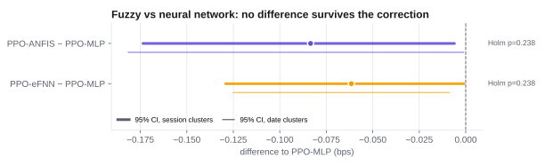
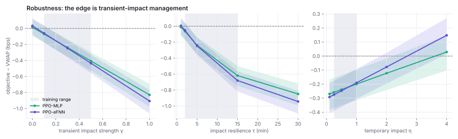
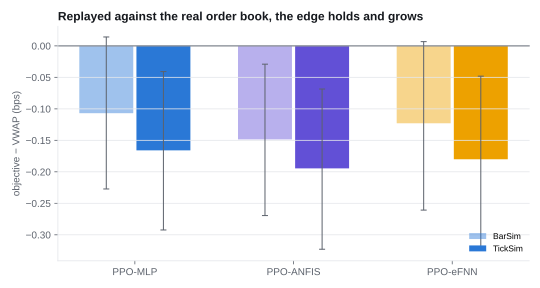
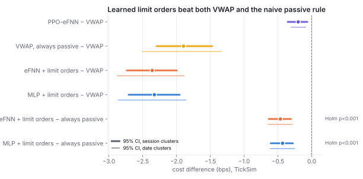
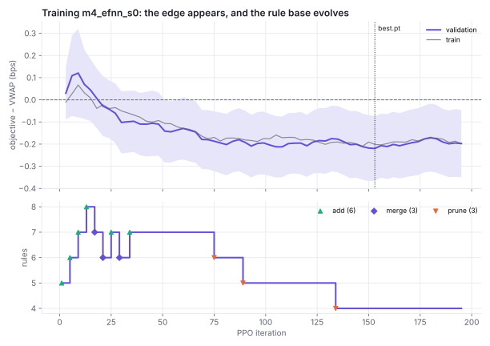
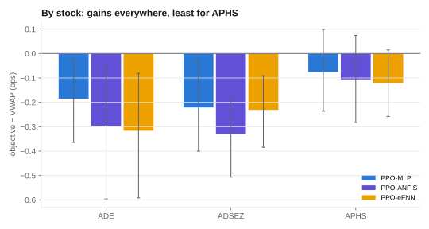

# Figures

Generated by `uv run hftf report figures` from the saved result tables; regenerate after
re-running experiments. SVG for the web, PNG (200 dpi) for documents.
Numbers: docs/RESULTS.md.

## Test split vs VWAP, our run and the replication

Held-out October test split (36 stock-sessions). Points: mean paired difference to VWAP; thick bars: 95% session-cluster bootstrap CI; thin bars: 95% date-cluster CI. Holm-adjusted Wilcoxon p over the three ensembles.

Source: `runs/reports/final_test_vs_vwap.csv; replication values from docs/RESULTS.md`

## Architecture comparison on the test split

Paired differences between seed ensembles on the test split, with session- and date-cluster CIs and Holm-adjusted p. The CIs nearly exclude zero, but no difference survives Holm in either run.

Source: `runs/reports/final_test_vs_group.csv`

## Impact robustness sweeps (validation)

Ensembles vs VWAP as one impact parameter moves inside (shaded) and outside the training range. The edge vanishes without transient impact and grows as it strengthens or persists; under very large temporary impact the policies lose to VWAP. Bands: 95% session-cluster CI.

Source: `runs/reports/robust_{gamma,tau_res_min,eta}.csv`

## BarSim vs TickSim on the val tick sessions

Ensembles vs VWAP on identical episodes in the bar simulator (light) and the tick-replay simulator (solid), 24 val tick sessions. Error bars: 95% session-cluster CI.

Source: `runs/reports/m5_val_{bar,tick}_vs_vwap.csv`

## Limit orders on the val tick sessions (TickSim)

Pace-only eFNN, the naive always-passive VWAP and the learned limit-order policies against VWAP, and the learned policies against the naive rule. Passive fills are counterfactual, so absolute passive gains are an upper bound; the gain over the naive rule shares that bias. The date-cluster Holm p (0.016) is the floor for 8 dates.

Source: `runs/reports/m5_lip_val_ticksim_vs_{vwap,group}.csv`

## Training curves and rule evolution (m4_efnn_s0)

Top: objective vs VWAP on the trainer's fixed validation episodes (±1.96 SE) and on train; the dotted line marks the selected checkpoint. Bottom: number of fuzzy rules, with accepted add / merge / prune events (every edit passed the KL guard).

Source: `runs/m4_efnn_s0/progress.csv, runs/m4_efnn_s0/events.csv`

## Test split by stock

Ensembles vs VWAP per stock on the test split, 95% session-cluster CIs (12 sessions each).

Source: `runs/reports/final_test_rows.csv`
